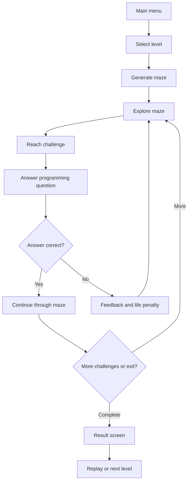
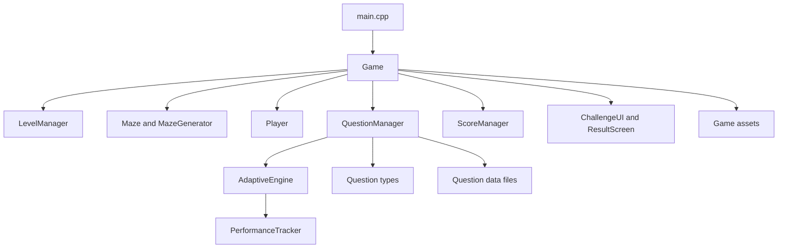

# CodeMaze — Adaptive C++ Learning Maze

CodeMaze is a 2D educational game built with C++ and SFML. Players explore a maze and encounter programming challenges at designated locations. Correct answers allow progression; incorrect answers can cost a life and provide feedback or a hint.

The project combines maze gameplay, C++ practice, performance tracking, and adaptive question selection.

## Project overview

**Problem:** Programming practice can feel disconnected from interactive learning. CodeMaze places C++ questions inside a playable maze so learners practise concepts while progressing through levels.

**Core loop:**



## Features

- 2D maze gameplay and level progression.
- Configurable maze sizes (10×10, 15×15, 20×20, and 25×25 are described in the project documentation).
- C++ multiple-choice and other question types represented in the question loader (MCQ, Output, and Debugging).
- Question topics and difficulty levels.
- Lives, score, challenge timer, and hints.
- Performance tracking, including attempts, correct answers, topic performance, hints used, and lives lost.
- Adaptive topic and difficulty selection based on recorded topic performance.
- Result screen and learning feedback.
- Question-history handling to reduce repeated questions within a question cycle.

## Adaptive learning approach

The adaptive engine uses topic-level performance to classify a topic as **Weak**, **Normal**, or **Mastered**, subject to a minimum-attempt requirement. It maps these levels to Easy, Medium, and Hard question difficulty respectively.

The question manager first tries to select a question matching the preferred topic and difficulty. If none is available, it falls back to another question from that topic and then to an unused question. When the current question cycle is exhausted, question history is reset.

The topic-selection logic gives priority to weaker and normal topics while retaining some opportunity to revisit mastered topics. The exact thresholds and selection weights are defined in the source code and may change as the project evolves.

## Architecture



### Main modules

| Module | Responsibility |
|---|---|
| Game | Main game loop, state transitions, and coordination |
| LevelManager | Level-specific configuration |
| Maze / MazeGenerator | Maze structure, generation, and challenge placement |
| Player | Player position and movement |
| Questions / QuestionManager | Loading, selecting, and managing questions |
| Learning / AdaptiveEngine | Topic selection and difficulty adaptation |
| Learning / PerformanceTracker | Records player performance by topic |
| Scoring / ScoreManager | Score calculation and reset |
| UI / ChallengeUI | Displays programming challenges |
| UI / ResultScreen | Presents end-of-level results |

## Technology stack

| Technology | Purpose |
|---|---|
| C++20 | Main programming language |
| SFML 3.x (project configured for 3.1.0) | Window, graphics, and input |
| CMake | Build configuration |
| MSVC / Visual Studio | Windows compiler and development environment |
| Git and GitHub | Version control and source hosting |
| Text-based question data | Local question bank |

## Repository layout

```text
CodeMaze/
├── CodeMaze/
│   └── CMakeLists.txt
├── src/
│   ├── main.cpp
│   ├── Game/
│   ├── Maze/
│   ├── Player/
│   ├── Questions/
│   ├── Learning/
│   ├── Scoring/
│   └── UI/
├── data/
├── assets/
├── CMakeLists.txt
└── README.md
```

## Requirements

The current CMake project is configured for Windows and MSVC.

- Windows 10/11 (documented development environment).
- Visual Studio with the **Desktop development with C++** workload / MSVC toolchain.
- CMake 3.10 or later (a newer version is recommended).
- SFML 3.1.0 development package.
- Git.

The project uses C++20 and links the SFML Graphics component. Install the SFML package that matches your compiler, architecture, and build configuration.

## Build and run (Windows / Visual Studio)

### 1. Clone the repository

```powershell
git clone https://github.com/niranjanhm21/CodeMaze.git
cd CodeMaze
```

### 2. Install and locate SFML

Install the SFML 3.1.0 development package for your MSVC toolchain. Find the directory containing SFML's CMake package configuration (the folder containing `SFMLConfig.cmake`).

For example, if SFML is extracted to `C:\Libraries\SFML-3.1.0`, the package directory may be:

```text
C:\Libraries\SFML-3.1.0\lib\cmake\SFML
```

Use the actual location on your machine in the next command.

### 3. Configure with CMake

From the repository root:

```powershell
cmake -S . -B build -DSFML_DIR="C:/Libraries/SFML-3.1.0/lib/cmake/SFML"
```

Replace the example path with the directory that contains `SFMLConfig.cmake`.

### 4. Build

```powershell
cmake --build build --config Release
```

### 5. Run

Open the generated solution in the `build/` directory with Visual Studio and run the `CodeMaze` target, or launch the generated `CodeMaze.exe` from its configuration output directory.

The Windows post-build step copies the SFML runtime DLLs (when provided by the package) and the repository's `data/` and `assets/` folders beside the executable.

## Question data format

The question loader reads pipe-delimited records. The current parser expects at least ten fields:

```text
type|topic|difficulty|prompt|optionA|optionB|optionC|optionD|answer|hint
```

The question manager recognizes these type strings:

- `MCQ`
- `Output`
- `Debugging`

For MCQ records, the answer field is stored as `A`, `B`, `C`, or `D` and is converted to the original option text before the options are shuffled. Ensure each record follows the expected field order.

## Controls

The project documentation describes these controls; confirm them against the current build if controls are changed:

| Key | Action |
|---|---|
| W / A / S / D or arrow keys | Move |
| 1–4 | Select an answer |
| Enter | Submit |
| H | Request a hint |
| Esc | Return / exit the current screen |
| R | Replay / reset where available |
| N | Continue to the next level where available |

## Screenshots and demo

Capture real screenshots from the running Windows build and add them under `docs/screenshots/`. See [the screenshot capture checklist](docs/SCREENSHOTS.md) for recommended views and filenames.

## Limitations

- The current project is focused on C++ learning.
- The question bank is stored locally.
- The documented implementation is primarily single-player.
- Online multiplayer and cloud-based learning analytics are not part of the current core project.
- Adaptive question selection is based on recorded performance and the rules implemented in the local adaptive engine.

## Possible future work

- Expand the question bank and add more topics.
- Add automated tests for maze, question selection, and scoring logic.
- Improve accessibility and input options.
- Add optional learning-progress export.
- Evaluate the adaptive learning experience with learners.

## License

No license file was identified during this documentation review. Unless a license is added to the repository, reuse and redistribution permissions are not explicitly granted.
