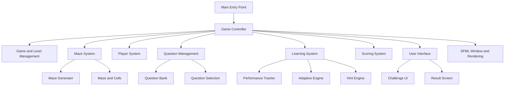
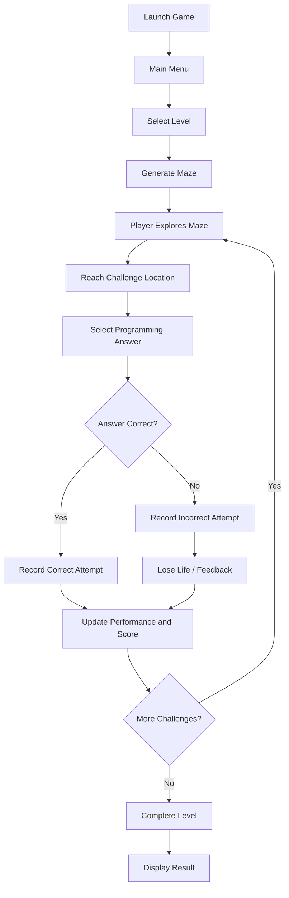
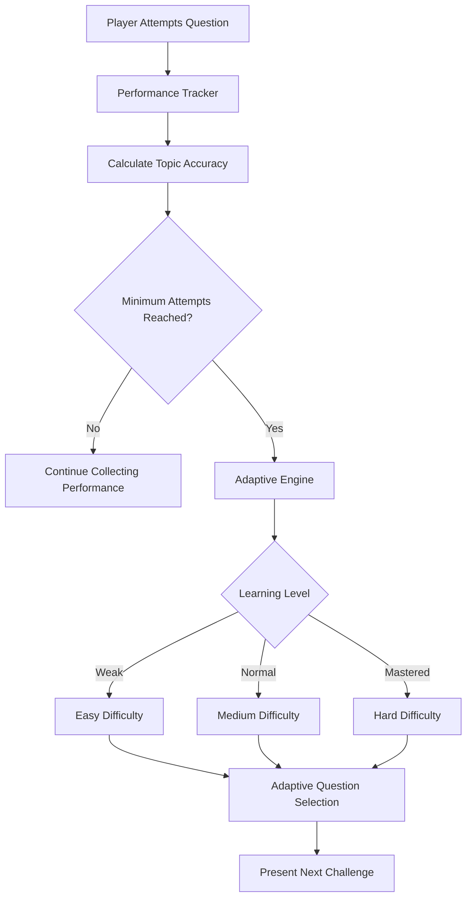

# CodeMaze — System Architecture

## 1. Overview

CodeMaze is a 2D educational maze game developed using C++20 and SFML 3.1.0.

The game combines maze exploration with C++ programming challenges. Players navigate through generated mazes and answer questions to progress.

The system also tracks player performance and uses an adaptive learning mechanism to select questions based on topic-wise performance.

## 2. Technology Stack

| Component | Technology |
|---|---|
| Programming Language | C++20 |
| Graphics Library | SFML 3.1.0 |
| Compiler | MSVC |
| Development Environment | Visual Studio Community |
| Build System | CMake |
| Version Control | Git and GitHub |

## 3. High-Level Architecture

The project is organized into modular components coordinated by the main Game class.

## 4. Main Modules

### 4.1 Game Module

Main components:
- `Game.cpp`
- `Game.h`
- `LevelManager.cpp`
- `LevelManager.h`

Responsibilities:
- Controls the overall game flow.
- Manages game states such as Main Menu, Instructions, Level Selection, Playing, Challenge, Won, Game Over, and Result.
- Coordinates the maze, player, questions, learning system, and scoring.
- Handles events, updates, and rendering.

### 4.2 Maze Module

Main components:
- `Maze.cpp`
- `Maze.h`
- `MazeGenerator.cpp`
- `MazeGenerator.h`
- `Cell.h`

Responsibilities:
- Generates maze layouts.
- Creates passages and walls.
- Manages maze cells.
- Supports maze exploration and challenge locations.

### 4.3 Player Module

Main components:
- `Player.cpp`
- `Player.h`

Responsibilities:
- Manages player position.
- Handles player movement.
- Interacts with maze boundaries and walkable paths.

### 4.4 Questions Module

Main components:
- `Question.cpp`
- `Question.h`
- `QuestionManager.cpp`
- `QuestionManager.h`

Responsibilities:
- Loads questions from the question data file.
- Organizes questions by topic and difficulty.
- Selects questions for challenges.
- Supports adaptive question selection.
- Tracks used questions to avoid unnecessary repetition.

### 4.5 Learning Module

Main components:
- `AdaptiveEngine.cpp`
- `AdaptiveEngine.h`
- `PerformanceTracker.cpp`
- `PerformanceTracker.h`
- `HintEngine.cpp`
- `HintEngine.h`

Responsibilities:

**Performance Tracker**
- Records attempts and correct or incorrect answers.
- Tracks topic-wise performance.
- Records hints used and lives lost.
- Calculates accuracy and average time.

**Adaptive Engine**
- Classifies learning performance into Weak, Normal, and Mastered levels.
- Uses topic-wise performance to select suitable question difficulty.
- Requires a minimum number of attempts before classifying a topic.

**Hint Engine**
- Provides the game's hint-related functionality.

### 4.6 Scoring Module

Main components:
- `ScoreManager.cpp`
- `ScoreManager.h`

Responsibilities:
- Handles score-related calculations.
- Supports scoring during gameplay and challenges.

### 4.7 User Interface Module

Main components:
- `ChallengeUI.cpp`
- `ChallengeUI.h`
- `ResultScreen.cpp`
- `ResultScreen.h`

Responsibilities:
- Displays programming challenges.
- Presents challenge-related information.
- Displays the player's result screen.

## 5. Game Workflow

## 6. Adaptive Learning Workflow

The adaptive learning system uses previous player performance to guide question selection.

The current implementation uses performance thresholds of:
- Below 50%: Weak
- 50% to below 80%: Normal
- 80% or above: Mastered

A minimum of two attempts is required before topic classification.

## 7. Performance Tracking

The PerformanceTracker maintains topic-wise statistics.

Important measurements include:

- Total attempts.
- Correct answers.
- Incorrect answers.
- Topic-wise accuracy.
- Hints used.
- Lives lost.
- Total time used.

Accuracy is calculated as:

**Accuracy = (Correct Answers / Total Attempts) × 100**

## 8. Question Management

The QuestionManager manages the question bank and question selection process.

Its responsibilities include:

1. Loading questions from a file.
2. Organizing available questions.
3. Selecting questions randomly or by topic.
4. Supporting adaptive question selection.
5. Tracking previously used questions.
6. Resetting question history when necessary.

## 9. Build and Runtime Organization

CMake is used to configure the project and link the SFML Graphics component.

The Windows build configuration also copies the required runtime DLLs and the `data` and `assets` directories beside the executable.

## 10. Future Improvements

- Add automated unit tests for maze generation and adaptive learning.
- Improve adaptive learning using additional performance measurements.
- Expand the question bank.
- Improve game accessibility and user experience.
- Add persistent player performance across game sessions.
- Improve cross-platform build configuration.

---

**Note:** This document describes the current source-code structure and intended module responsibilities. It does not claim that future improvements have already been implemented.
